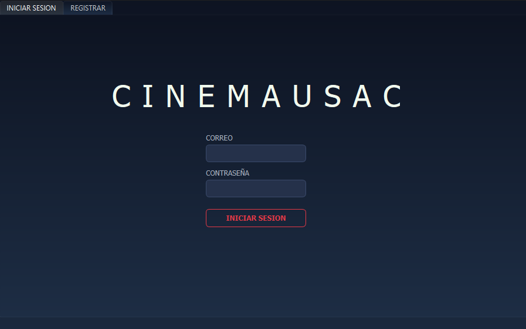
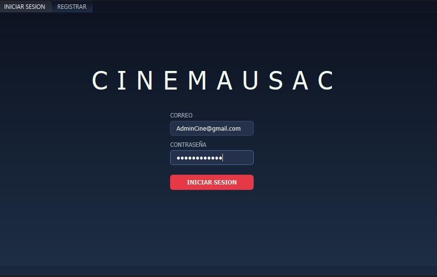
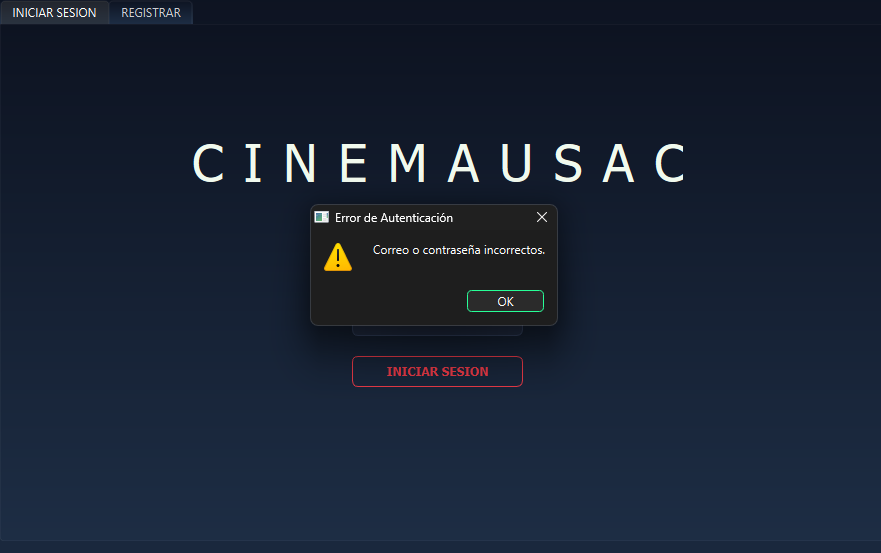
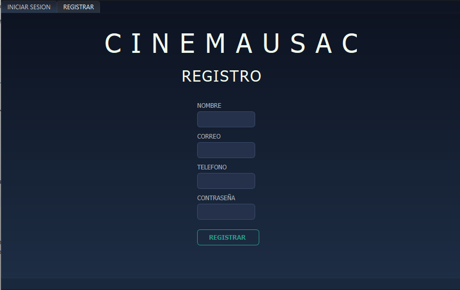
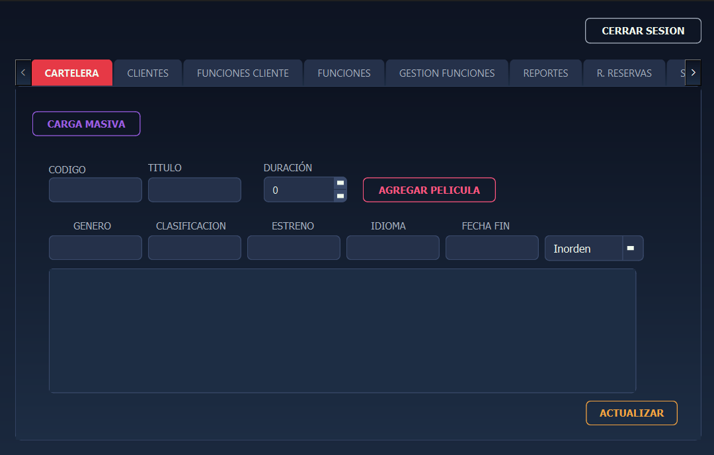
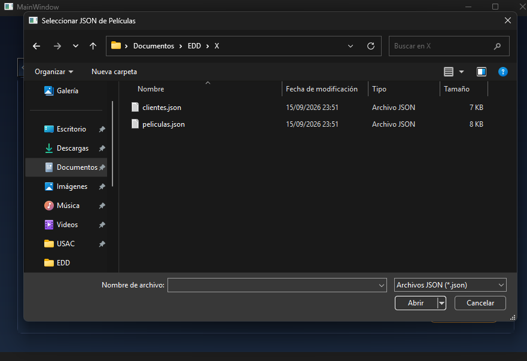
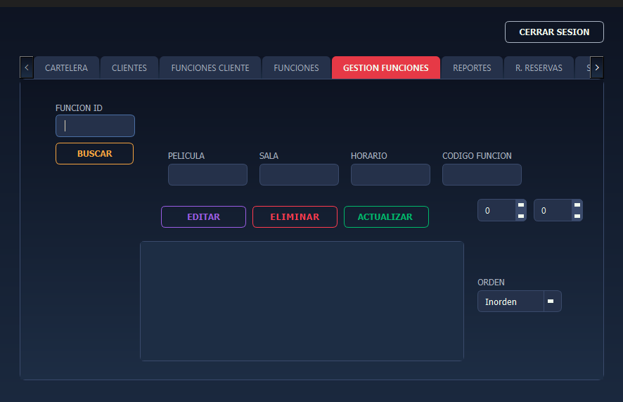
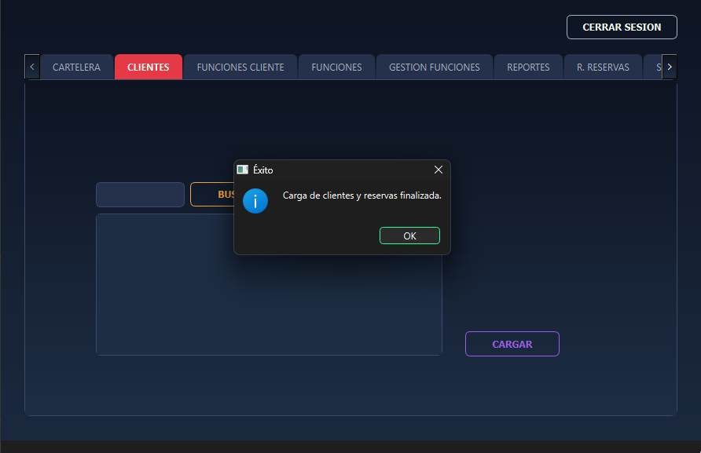
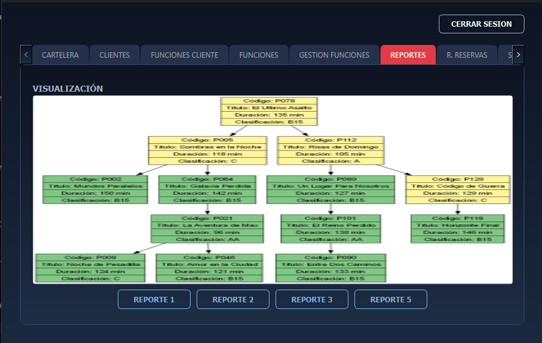
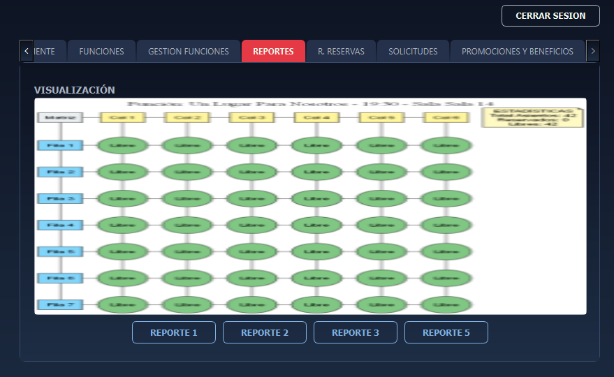

# Manual de Usuario — CinemaUSAC (EDD Fase 2)

**Universidad de San Carlos de Guatemala**

**Facultad de Ingeniería — Escuela de Ciencias y Sistemas**

**Curso:** Estructuras de Datos

**Proyecto:** EDD CinemaUSAC — Fase 2

**Carné:** 202303371

**Tecnología de interfaz:** Qt Widgets (C++), aplicación de escritorio

---

## 1. Introducción

Este manual explica, paso a paso y desde la perspectiva de un usuario final, cómo utilizar el sistema **CinemaUSAC**. La aplicación tiene dos roles: **Administrador** y **Cliente**, cada uno con su propio menú luego de iniciar sesión.

El sistema permite administrar la cartelera de películas, las funciones de cada película, los clientes registrados y sus reservas de asientos, además de generar reportes gráficos con Graphviz que muestran el estado interno de cada estructura de datos.

---

## 2. Inicio de la aplicación

Al ejecutar el programa se abre la ventana principal en la pestaña **INICIAR SESION**.

En esta pantalla existen dos sub-pestañas:

- **INICIAR SESION**: para ingresar con una cuenta ya existente (administrador o cliente).
- **REGISTRAR**: para que un cliente nuevo cree su cuenta.

---

## 3. Inicio de sesión

1. Ingresa tu **correo** en el campo correspondiente.
2. Ingresa tu **contraseña**.
3. Presiona el botón **Iniciar Sesión**.

El sistema valida las credenciales de dos formas:

- **Administrador:** si el correo y la contraseña coinciden exactamente con las credenciales fijas del sistema (`AdminCine@gmail.com` / `admin123Pass`), se abre el **Panel de Administrador**.
- **Cliente:** si el correo y la contraseña coinciden con un cliente ya registrado en el Árbol B, se abre el **Panel de Cliente (Taquilla)** con un mensaje de bienvenida personalizado.

Si el correo o la contraseña no existen o están vacíos, aparecerá un mensaje de advertencia indicando el error (campos vacíos o credenciales incorrectas).

---

## 4. Registro de un nuevo cliente

Desde la pestaña **REGISTRAR**:

1. Completa los campos: **nombre**, **correo**, **teléfono** y **contraseña**.
2. Presiona el botón de registrar.

El sistema valida que el correo no haya sido utilizado previamente; si ya existe, el registro se rechaza y se muestra un mensaje indicando el motivo. Si el registro es exitoso, el cliente queda almacenado en el Árbol B y puede iniciar sesión inmediatamente con sus nuevas credenciales.

---

## 5. Panel de Administrador

Al iniciar sesión como administrador se muestra un menú con varias pestañas: **CARTELERA**, **FUNCIONES / GESTIÓN DE FUNCIONES**, **CLIENTES**, **SOLICITUDES**, **PROMOCIONES Y BENEFICIOS** y **REPORTES**.

### 5.1 Pestaña CARTELERA (Películas)

Aquí el administrador gestiona el catálogo de películas (Árbol Binario de Búsqueda).

**Agregar película**

1. Llena los campos: código, título, género, duración, clasificación, idioma, fecha de estreno y fecha de fin.
2. Presiona **Agregar Película**.

Si algún campo tiene un formato inválido (por ejemplo, una fecha mal escrita o la duración no numérica), el sistema muestra un mensaje señalando el campo específico y el formato esperado, y no guarda el registro.

**Carga masiva de películas y funciones**

1. Presiona el botón **Carga Masiva**.
2. Selecciona el archivo `.json` con la estructura de películas y funciones (ver ejemplo en la carpeta de pruebas del repositorio).
3. El sistema procesa el archivo, valida cada registro y agrega al árbol únicamente las películas y funciones correctas; los registros inválidos se reportan y se descartan sin afectar el resto de la carga.

**Buscar, editar y eliminar película**

- Usa el campo de búsqueda por código y el botón **Buscar Película** para localizar una película específica.
- Usa el botón de editar para modificar los datos de una película existente.
- Usa el botón de eliminar para quitarla del árbol (sus funciones asociadas quedan huérfanas si no se eliminan antes).

**Ver cartelera completa**

Presiona **Actualizar Cartelera** para listar todas las películas registradas en la tabla. Se puede elegir el orden de recorrido (**preorden, inorden o postorden**) desde el combo `cmbOrdenPeliculas`.

Las películas cuya fecha de fin esté a menos de 7 días se marcan visualmente como próximas a finalizar cartelera.

### 5.2 Pestaña FUNCIONES / GESTIÓN DE FUNCIONES

Aquí se administran las funciones (Árbol AVL, indexado por `codigo_funcion`).

**Crear función**

1. Selecciona la película desde el combo (`cbmFuncionPeli`).
2. Ingresa horario, sala, filas y columnas.
3. Presiona **Crear Función**.

Al crear la función, el sistema:

- Genera automáticamente el `codigo_funcion`.
- Inserta el nodo en el Árbol AVL, balanceando automáticamente si es necesario.
- Crea el archivo `F00X_funcion.json` con la lista de asientos ocupados vacía.

**Editar función**

1. En la tabla de funciones registradas, haz clic sobre la fila de la función que deseas modificar.
2. Ajusta los campos que necesites.
3. Presiona **Editar Función** para guardar los cambios.

**Eliminar función**

Selecciona la función y presiona **Eliminar Función**. El sistema elimina el nodo del AVL (reequilibrando el árbol si corresponde) y borra el archivo `.json` de asientos asociado a esa función.

**Listar y buscar funciones**

- **Actualizar Tabla de Funciones**: recorre el AVL completo y llena la tabla; se puede elegir el orden con el combo de gestión de funciones (`cmbGestionFuncion`): preorden, inorden o postorden.
- **Buscar Función**: localiza una función específica por su código usando una búsqueda binaria dentro del AVL.

### 5.3 Pestaña CLIENTES

Aquí se administra el catálogo de clientes (Árbol B de orden 4).

**Carga masiva de clientes y reservas**

1. Presiona **Carga Masiva Clientes**.
2. Selecciona el archivo `.json` con clientes y sus reservas.
3. El sistema inserta cada cliente válido en el Árbol B y cada reserva en la Tabla Hash, rechazando los registros con datos incompletos o inválidos.

**Listar clientes**

El botón de actualizar tabla recorre el Árbol B en orden (por `id`) y muestra todos los clientes registrados. Se puede elegir el orden desde el combo `cmbOrdenClientes`.

**Buscar cliente**

Ingresa el ID del cliente y presiona **Buscar Cliente**; el sistema localiza el nodo en el Árbol B y muestra su información.

**Ver reservas de un cliente**

Ingresa el ID del cliente y presiona **Consultar Estado** (reservas). El sistema:

1. Ubica al cliente en el Árbol B.
2. Toma la lista de `codigo_reserva` asociados a ese cliente.
3. Consulta cada reserva en la Tabla Hash general.
4. Muestra función, fila, columna, fecha y estado de cada reserva.

**Eliminar cliente**

Selecciona el cliente y presiona **Eliminar Cliente**. El sistema elimina el nodo del Árbol B (redistribuyendo o fusionando nodos si es necesario) y elimina en cascada todas sus reservas de la Tabla Hash y de los archivos de función correspondientes.

### 5.4 Pestaña SOLICITUDES

Gestiona la cola circular de solicitudes especiales, heredada de la Fase 1:

- **Cargar Solicitud**: muestra la solicitud que está al frente de la lista.
- **Aprobar Solicitud**: marca la solicitud como atendida y avanza la cola.
- **Rechazar Solicitud**: elimina la solicitud de la lista.
- **Consultar Estado**: busca una solicitud por teléfono del cliente.

### 5.5 Pestaña PROMOCIONES Y BENEFICIOS

Permite crear promociones y añadirles beneficios, y consultar el listado completo (funcionalidad heredada de Fase 1, sin cambios).

### 5.6 Pestaña REPORTES

Desde esta pestaña se generan los reportes gráficos con Graphviz de cada estructura:

| Botón | Estructura | Reporte generado |
|---|---|---|
| Ver reporte de cartelera | BST de películas | Árbol con código, título, duración y clasificación (verde: en cartelera, amarillo: próximo a retirar) |
| Reporte AVL | Árbol AVL de funciones | Nodos circulares (verde: programada, rojo: ya realizada) |
| Reporte Árbol B | Árbol B de clientes | Nodos tipo "caja" con hasta 4 claves por nodo |
| Reporte de reservas | Tabla Hash de reservas | Buckets numerados, colisiones como listas enlazadas y estadísticas generales |
| Reporte matriz dispersa | Matriz dispersa de asientos | Mapa de asientos de la función actualmente cargada en memoria (libres/ocupados) |

> Para generar el reporte de la Matriz Dispersa, primero debes tener una función cargada (ver sección 6.3): el reporte siempre corresponde a la función que está activa en memoria en ese momento.

Cada botón regenera el archivo `.dot` correspondiente, ejecuta Graphviz para producir el `.png`/`.pdf` y lo despliega directamente en la interfaz, por lo que siempre refleja el estado más reciente de la estructura.

### 5.7 Cerrar sesión (Administrador)

Presiona **Cerrar Sesión** para volver a la pantalla de inicio de sesión.

---

## 6. Panel de Cliente (Taquilla)

Al iniciar sesión como cliente se abre el panel con las pestañas: **RESERVACIONES**, **MAPA ASIENTOS**, **HISTORIAL RESERVA**, **EDITAR PERFIL** y **REALIZAR SOLICITUDES**.

### 6.1 Pestaña RESERVACIONES

1. Selecciona una película desde el combo de cartelera (`cmbPeliculaReserva`). Esta lista proviene del BST de películas.
2. Al elegir la película, el combo de funciones se actualiza automáticamente mostrando únicamente las funciones asociadas a esa película (resuelto mediante el Árbol AVL).
3. Selecciona la función deseada.

Al seleccionar una función, el sistema carga en memoria el archivo `F00X_funcion.json` correspondiente y llena la matriz dispersa activa con los asientos ya ocupados.

### 6.2 Pestaña MAPA ASIENTOS

Muestra en una tabla el mapa completo de asientos de la función seleccionada: libres y ocupados.

**Reservar un asiento**

1. Indica la fila y columna del asiento que deseas reservar (`spinFila` y `spinColumna`).
2. Presiona **Reservar**.

El sistema valida que el asiento exista y esté libre; si es así:

- Marca el asiento como ocupado en la matriz dispersa activa.
- Persiste el cambio en el archivo `F00X_funcion.json` de esa función.
- Registra la reserva en la Tabla Hash general usando un nuevo `codigo_reserva`.

Si el asiento ya está ocupado o los datos ingresados son inválidos, se muestra un mensaje de error y no se modifica ninguna estructura.

**Cancelar una reserva**

1. Indica el `codigo_reserva` que deseas cancelar.
2. Presiona **Cancelar Reserva**.

El sistema busca la reserva en la Tabla Hash, la elimina de ahí y del archivo de la función correspondiente, y marca el asiento como libre en la matriz dispersa (cargándola primero si no era la función activa en pantalla).

### 6.3 Pestaña HISTORIAL RESERVA

Presiona **Actualizar** para consultar todas las reservas realizadas por el cliente actualmente autenticado. El sistema:

1. Ubica al cliente por su `id` en el Árbol B.
2. Recupera sus códigos de reserva.
3. Consulta cada uno en la Tabla Hash general.
4. Muestra: código, función, fecha, fila, columna y estado (**VALIDA** o **VENCIDA**, según si la fecha de la función ya pasó).

Esta consulta es de solo lectura: no carga los archivos de asientos de las funciones ni modifica la matriz dispersa.

### 6.4 Pestaña EDITAR PERFIL

Permite modificar los datos personales del cliente (nombre, teléfono, contraseña). Presiona **Guardar Perfil** para confirmar los cambios, que se actualizan directamente en el Árbol B.

### 6.5 Pestaña REALIZAR SOLICITUDES

Permite enviar una solicitud especial al administrador (tipo, descripción, teléfono), la cual queda registrada en la lista circular doblemente enlazada de solicitudes para su posterior gestión desde el panel de administrador.

### 6.6 Cerrar sesión (Cliente)

Presiona **Cerrar Sesión** para volver a la pantalla de inicio de sesión.

---

## 7. Mensajes de validación y errores comunes

El sistema muestra mensajes emergentes (`QMessageBox`) para guiar al usuario ante datos inválidos, tanto al llenar formularios como al cargar archivos JSON:

| Situación | Mensaje que verás |
|---|---|
| Campo de fecha con formato incorrecto | Se indica el campo y el formato esperado (`AAAA-MM-DD`) |
| Campo numérico (filas, columnas, duración, ID) con texto no numérico | Se indica el campo y que se espera un número |
| Campo obligatorio vacío | Se indica cuál campo falta por completar |
| Correo ya registrado | Se rechaza el registro del cliente |
| Asiento ya ocupado | Se indica que el asiento no está disponible |
| Código de reserva/función/cliente inexistente | Se indica que no se encontró el registro buscado |
| Archivo JSON con registros inválidos | Se listan los registros rechazados sin afectar los válidos |

---

## 8. Recomendaciones de uso

- Realiza siempre la carga masiva de películas/funciones antes que la de clientes/reservas, ya que las reservas referencian `codigo_funcion` existentes.
- Antes de eliminar una función, verifica que no tenga reservas activas importantes, ya que se elimina su archivo de asientos.
- Genera los reportes desde la pestaña **REPORTES** después de realizar cambios importantes, para verificar visualmente el estado balanceado del AVL y del Árbol B.
- Usa el archivo de prueba incluido en el repositorio (`/pruebas` o carpeta indicada) para validar rápidamente la carga masiva sin capturar datos manualmente.

---

## 9. Créditos

**Fuente de las capturas:** Elaboración propia, 2026.
**Proyecto:** EDD CinemaUSAC — Fase 2, Estructuras de Datos, Universidad de San Carlos de Guatemala.
