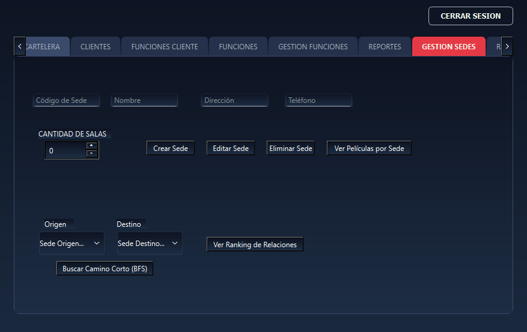
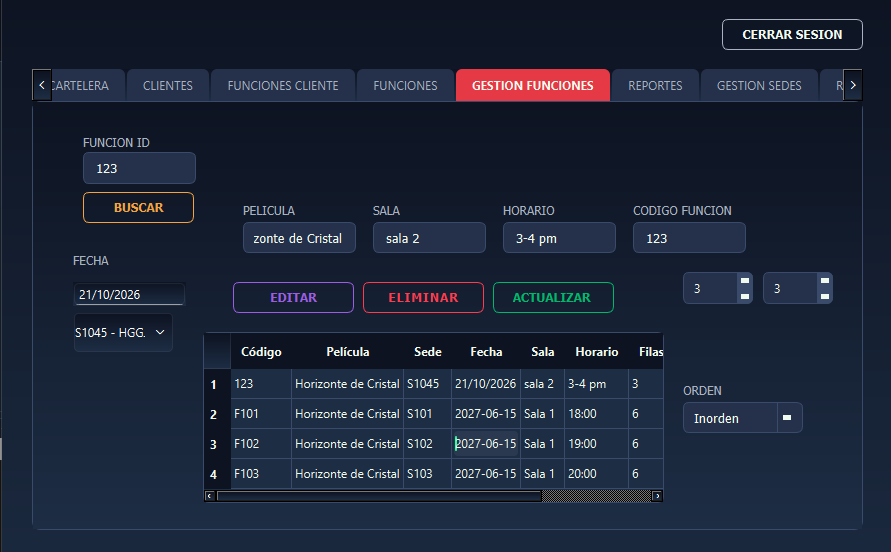
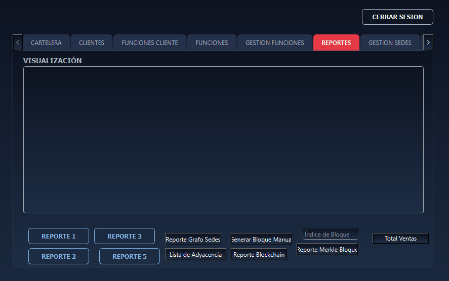
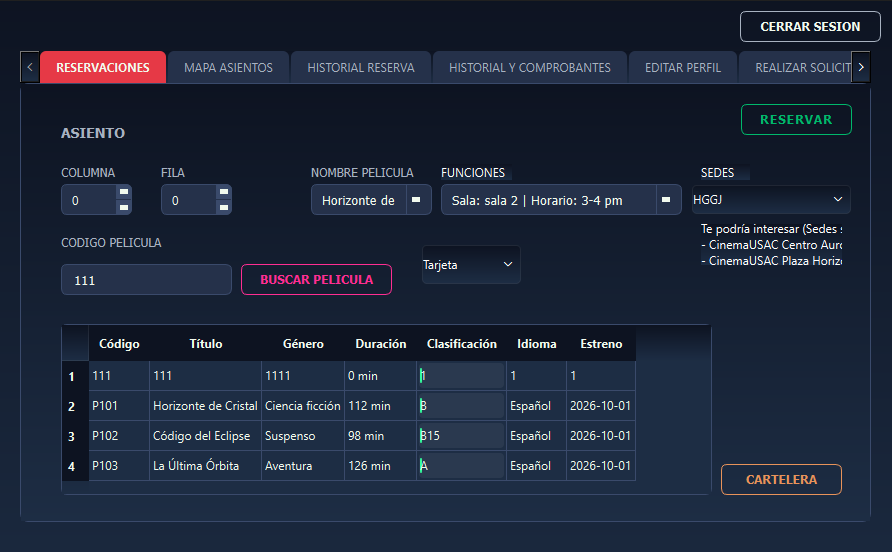
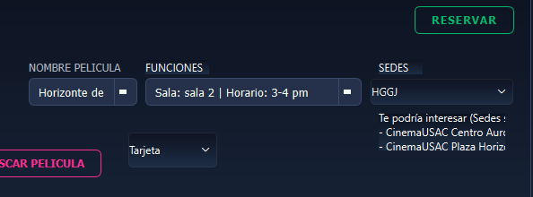
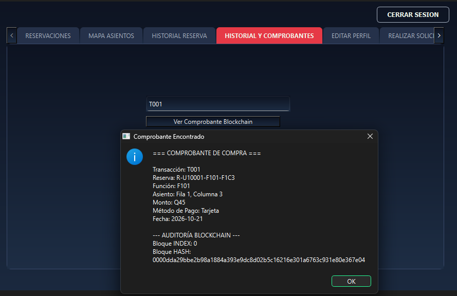

# Manual de Usuario - CinemaUSAC

**Universidad de San Carlos de Guatemala**

**Facultad de Ingeniería — Escuela de Ciencias y Sistemas**

**Curso:** Estructuras de Datos

**Proyecto:** EDD CinemaUSAC — Fase 2

**Carné:** 202303371

## 1. Introducción
Bienvenido al manual de usuario del sistema **CinemaUSAC**. Esta aplicación de escritorio ha sido diseñada para administrar eficientemente las operaciones de una red de cines, permitiendo a los administradores gestionar sedes, películas, funciones, clientes y reportes de manera centralizada. Al mismo tiempo, ofrece a los usuarios finales (clientes) una plataforma intuitiva para consultar la cartelera, adquirir boletos, recibir recomendaciones y consultar su historial de compras con un alto nivel de seguridad.

## 2. Objetivo del manual
El propósito de este documento es guiar paso a paso tanto a los administradores como a los clientes en el uso correcto de las herramientas que ofrece CinemaUSAC. Al finalizar la lectura, el usuario será capaz de navegar por el sistema, comprender sus módulos y ejecutar cualquier transacción sin requerir conocimientos técnicos.

## 3. Descripción general del sistema
CinemaUSAC es un sistema de escritorio robusto. Entre sus características principales destacan:
*   **Gestión Centralizada:** Control de múltiples sedes, películas y programación de funciones desde un solo lugar.
*   **Persistencia Automática:** El sistema guarda todo el progreso automáticamente al cerrarse y lo recupera al volver a iniciar.
*   **Seguridad y Auditoría:** Todas las compras se registran de forma inmutable mediante tecnología de cadena de bloques (Blockchain), asegurando que los boletos sean auténticos e inalterables.
*   **Sistema de Recomendación:** Sugerencias inteligentes de sedes basadas en la afinidad de su cartelera.

## 4. Requisitos para utilizar el sistema
*   Sistema operativo Windows, macOS o Linux.
*   Resolución de pantalla mínima recomendada de 1280x720.
*   Mouse y teclado estándar.

---

## 5. Acceso al sistema e inicio de sesión

Al iniciar la aplicación, la primera pantalla visible es el **Portal de Acceso**. El sistema está protegido y requiere credenciales válidas.

**Pasos para iniciar sesión:**
1. Ingrese su **Correo Electrónico** en el primer campo de texto.
2. Ingrese su **Contraseña** en el segundo campo.
3. Haga clic en el botón **"Iniciar Sesión"**.
4. El sistema detectará automáticamente si sus credenciales pertenecen a un **Administrador** o a un **Cliente** y lo redirigirá a la interfaz correspondiente.
5. *Nota:* Si aún no tiene una cuenta, un administrador debe registrarlo en el sistema.

---

## 6. Módulo de Administrador

Esta interfaz es de acceso exclusivo para el personal gerencial del cine. Cuenta con un panel de control con múltiples pestañas para cada área operativa.

### 6.1 Cargas Masivas y Cartelera
Permite inicializar el sistema cargando múltiples registros de una sola vez mediante archivos de configuración.

1. Navegue a la pestaña principal.
2. Haga clic en **"Carga Masiva Películas"** para registrar sedes, películas y funciones iniciales.
3. Haga clic en **"Carga Masiva Clientes"** para importar la base de datos de usuarios.
4. Para visualizar las películas activas, presione **"Actualizar Cartelera"**. 
5. *Alerta visual:* Si una película está a 7 días o menos de salir de cartelera, la fila se resaltará en **color rojo claro**.

### 6.2 Gestión de Sedes
Módulo para administrar las sucursales físicas del cine y analizar sus relaciones comerciales.

*   **Crear/Editar/Eliminar:** Ingrese el código, nombre, dirección, cantidad de salas y teléfono. Utilice los botones de acción para actualizar el catálogo de cines.
*   **Ver Películas por Sede:** Ingrese el código de una sede y presione el botón correspondiente para ver un listado de todas las películas que se proyectan allí.
*   **Buscar Camino Corto:** Si desea saber cómo llegar de una Sede A a una Sede B a través de su red de películas compartidas, seleccione el origen y destino en los selectores y presione **"Buscar Camino Corto (BFS)"**.
*   **Ranking de Relaciones:** Presione el botón **"Ver Ranking"** para desplegar una lista que le indicará qué sedes tienen la cartelera más parecida entre sí.

### 6.3 Gestión de Funciones
Permite crear las proyecciones específicas y visualizar las butacas.

*   **Crear Función:** Ingrese un código único (Ej: F001), seleccione la Película, seleccione la **Sede**, asigne una Fecha, Sala, Horario y defina la cantidad de filas y columnas de la sala. Haga clic en **"Crear"**.
*   **Editar/Eliminar:** Seleccione una función de la tabla inferior. Sus datos se cargarán arriba. Modifique lo necesario o elimínela del sistema.
*   **Visualizar Sala:** Seleccione una función en la pestaña principal de reservas, luego ingrese su código en este módulo y presione **"Reporte Matriz Dispersa"** para ver un esquema visual de qué butacas están libres u ocupadas.

### 6.4 Seguridad y Blockchain
Sección de auditoría financiera donde se respaldan todas las ventas.

*   **Generar Bloque Manual:** El sistema agrupa las ventas (transacciones). Presione este botón para empaquetar las transacciones recientes y guardarlas permanentemente en el sistema.
*   **Reporte Total Ventas:** Haga clic aquí para ver un resumen de todos los boletos vendidos y el dinero recaudado.
*   **Visores de Auditoría:** Ingrese el índice de un bloque y haga clic en **"Reporte Merkle Bloque"** para ver su estructura criptográfica interna, o haga clic en **"Reporte Blockchain"** para verificar que ningún dato del sistema ha sido alterado (aparecerá en verde si es seguro, o en rojo si fue hackeado).

---

## 7. Módulo de Cliente (Taquilla)

Esta interfaz está diseñada para que el usuario final consulte la cartelera y compre sus entradas de manera rápida e intuitiva.

### 7.1 Reserva de Boletos
El proceso de compra ha sido optimizado y cuenta con un sistema de recomendaciones.

1. En el primer menú desplegable, seleccione la **Película** que desea ver.
2. Inmediatamente, el segundo menú se actualizará mostrando únicamente las **Sedes** que tienen programada esa película. Seleccione su cine favorito.
3. *Sugerencia Inteligente:* Al elegir la sede, el sistema le mostrará un mensaje de **"Sedes Similares"** con recomendaciones de otros cines que podrían gustarle basados en su elección.
4. Elija la **Función** (Sala y horario) en el tercer menú.
5. Ingrese el número de **Fila** y **Columna** del asiento que desea ocupar.
6. Seleccione su **Método de Pago** (Tarjeta o Efectivo).
7. Haga clic en **"Reservar"**. El sistema generará su comprobante.

### 7.2 Mi Perfil e Historial de Compras
Consulte su información personal y verifique sus transacciones pasadas.

*   **Actualizar Perfil:** Modifique su nombre, correo, teléfono o contraseña y presione **"Guardar Cambios"**.
*   **Historial:** En la tabla inferior verá todas sus reservas pasadas y futuras. Las que ya pasaron de fecha se marcarán como "VENCIDAS".
*   **Ver Comprobante:** Si necesita ver el detalle de una compra específica, ingrese el *Código de Transacción* (ubicado en su tabla de historial) y presione **"Ver Comprobante Blockchain"**. Esto le garantizará la validez y el detalle financiero de su compra.

---

## 8. Validaciones, mensajes y errores comunes

El sistema está diseñado para guiarlo mediante alertas visuales si comete algún error:

*   **"Todos los campos son obligatorios":** Aparece si intenta guardar un registro dejando espacios en blanco.
*   **"Asiento Ocupado":** Se muestra si durante la reserva intenta elegir un asiento que otro cliente ya compró. Deberá elegir otras coordenadas.
*   **"La película sale de cartelera en X días":** Advertencia visual amarilla/roja en la tabla del Administrador para películas cuya fecha de vigencia está por terminar.
*   **"Transacción no encontrada o bloque corrupto":** Ocurre si intenta buscar un comprobante que no existe o si alguien intentó alterar maliciosamente los archivos del sistema desde fuera de la aplicación.

## 9. Cierre de sesión y Persistencia

Para salir de su cuenta, localice el botón **"Cerrar Sesión"** en la parte inferior de su pantalla. Esto lo devolverá al portal de acceso principal.

**Nota importante sobre el guardado:**
No existe un botón de "Guardar Archivo". El sistema CinemaUSAC cuenta con una tecnología de persistencia inteligente. Simplemente presione la **"X"** de la ventana para cerrar el programa; el sistema comprimirá y guardará toda la información automáticamente. Al abrirlo al día siguiente, todos los cines, clientes y reservas estarán exactamente donde los dejó.